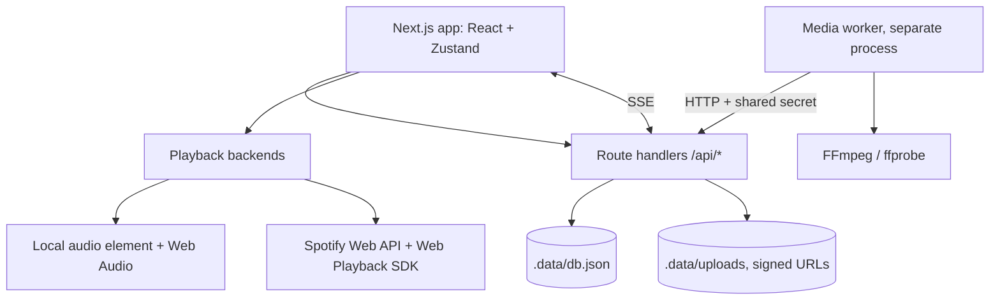

# Architecture (local-first build)

## Where the README's cloud pieces went

| README | This build | Swap point |
|---|---|---|
| Supabase Auth | local profile cookie (`/login`), signed guest tokens | `lib/server/http.ts` (`currentUser`), `lib/server/party.ts` (`requireMember`) |
| Postgres + RLS | JSON store, every access via repository functions that take an actor | `lib/server/db.ts` and the `T`/`M`/`S`/`R` table accessors |
| Supabase Realtime | SSE (`/api/events/:id/stream`) + in-process bus | `lib/server/bus.ts` |
| Cloudflare R2 | `.data/uploads` + HMAC-signed PUT/GET URLs, same flow as presigned URLs | `lib/server/storage.ts` |
| Inngest | DB-backed job queue + pull worker | `lib/server/recap.ts` |
| Python worker | Node/TypeScript worker (no Python installed here) | `workers/media/worker.ts` |

Row-level security is replaced by **domain-layer authorization**: the only way to obtain a member for an event is
`requireMember(eventKey, ctx)`, which needs a valid session or an event-bound guest token. Knowing an event id/slug grants nothing,
and non-members get the same `404` as a missing event. When moving to Postgres, express the same rules as RLS policies and keep these checks as defense in depth.

## Key decisions

1. **Deterministic visuals.** `computeFrame` is pure; the renderer only draws. No animation state, no wall clock. Seeking = calling it with another `t`.
2. **One clock.** `PlaybackClock` interpolates between authoritative reports (audio element, or Spotify polls/SDK events) and snaps on drift. Explicit browser output uses local SDK position reads, with epoch guards around asynchronous reads; remote-device follow mode keeps its existing API timestamp-age correction. Output selection is session-only and separate from device delay and per-song lyric offsets.
3. **Spotify is a controller, not an audio source.** Its backend never touches audio data. It controls/follows a Connect device. Features that need PCM or redistribution are disabled with explanations.
4. **Lyrics are provenance-tagged.** Each saved lyric records its source (`user-supplied`, `LRCLIB (community)`, `CC0 demo`).
5. **Privacy by construction.** Map coordinates are quantized before storage; recap eligibility (approved + consent) is re-checked at claim time, so media hidden after planning cannot be rendered.
6. **Heavy work never runs in a request.** Planning and FFmpeg live in the worker; the web app only queues and reports progress.

## Security checklist (implemented)

- Invite tokens: 192-bit random, stored as SHA-256, expiring, revocable, rotatable, max uses, optional scrypt passcode with throttling.
- Guest tokens: HMAC-signed, event-bound, secret hash checked against the member row, revocable by banning.
- Uploads: signed + expiring URLs, size caps (declared and actual), magic-number MIME sniffing, per-guest / per-event / storage limits, private objects, `nosniff` + sandbox CSP on served media, path-traversal-proof keys.
- CSRF: same-origin check on every cookie-authenticated write, `SameSite=Lax`, JSON-only bodies.
- Rate limits on login, join, passcodes, suggestions, votes, uploads, reports, friend requests, posts.
- Secrets: never in `NEXT_PUBLIC_`; the Spotify flow is a public PKCE client with no secret.
- Worker auth: constant-time shared-secret comparison; media served to the worker only for approved items.

## Local trust model (be aware)

There are no passwords: a "login" is a handle on this machine. That is fine for a single-user local build, not for exposing the app to the internet.
The Spotify tokens live in the browser's `localStorage`. The spec calls for encrypted server-side refresh tokens, which only makes sense once there is a real server-side account system.
