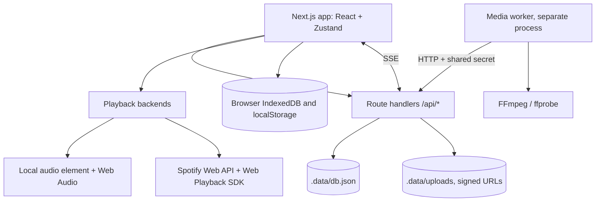

# Architecture

This document describes the implemented local-first build. The [original product specification](original-product-spec.md) is historical design context. Its cloud services, proposed routes and future features are not a description of the running app.



## Processes and persistence

The Next.js app serves the UI and API routes. `pnpm go` starts that web app and opens the browser. Recap processing requires the separate Node worker, started with `pnpm worker` or alongside the web app with `pnpm dev:all`. The optional English lyric aligner is a separate Python service and is not required for ordinary playback.

| Store | Contents | Boundary |
|---|---|---|
| `.data/db.json` | Local users, party membership/invites/requests, media metadata, recap projects/timelines/jobs, map and social rows | `lib/server/db.ts` and domain repositories |
| `.data/uploads` | Party uploads and rendered recap objects | `lib/server/storage.ts`, signed upload/read routes |
| `.data/secret.key` | Generated server signing secret when no environment secret is supplied | `lib/server/config.ts` |
| Browser IndexedDB | Imported audio and covers, playlists, saved lyrics and provenance, per-song look/correction/offset records and caches | `lib/library/db.ts` |
| Browser localStorage | Spotify tokens and public client ID, player queue/session, UI preferences and Studio saved themes | `lib/spotify/auth.ts`, `lib/player/controller.ts`, UI/Studio stores |

The server JSON store is an in-process table map with debounced persistence through a temporary file and rename. It is not a transactional database or a multi-process shared datastore. A backup of `.data` does not include browser library files or preferences. Browser storage is scoped to its origin and profile.

## Domain boundaries and future adapters

| Planned service | Current build | Swap point |
|---|---|---|
| Supabase Auth | local profile cookie (`/login`), signed guest tokens | `lib/server/http.ts` (`currentUser`), `lib/server/party.ts` (`requireMember`) |
| Postgres + RLS | JSON store, every access via repository functions that take an actor | `lib/server/db.ts` and the `T`/`M`/`S`/`R` table accessors |
| Supabase Realtime | SSE (`/api/events/:id/stream`) + in-process bus | `lib/server/bus.ts` |
| Cloudflare R2 | `.data/uploads` + HMAC-signed PUT/GET URLs, same flow as presigned URLs | `lib/server/storage.ts` |
| Inngest | DB-backed job queue + pull worker | `lib/server/recap.ts` |
| Dedicated media compute | Node/TypeScript worker over HTTP, with FFmpeg/ffprobe | `workers/media/worker.ts` |

Row-level security is replaced by **domain-layer authorization**: the only way to obtain a member for an event is
`requireMember(eventKey, ctx)`, which needs a valid session or an event-bound guest token. Knowing an event id/slug grants nothing,
and non-members get the same `404` as a missing event. When moving to Postgres, express the same rules as RLS policies and keep these checks as defense in depth.

## Playback and lyric time

`PlayerController` is the command entry point and drives one active backend: `LocalBackend` for imported/demo audio, or `SpotifyBackend` for Spotify. It owns the app queue, status, volume, Media Session integration and session restoration. `usePosition` interpolates display updates and also subscribes to command-position changes so a controlled seek slider cannot restore its old value before its next frame.

Spotify authentication is browser-side Authorization Code with PKCE. `lib/spotify/api.ts` handles Web API requests, token refresh, error mapping and rate-limit backoff. `lib/spotify/sdk.ts` registers the current tab as the Connect device **Lyricscape**. Premium is required for browser playback. `Play on this browser` transfers to that device and keeps track starts and controls targeted there. `Follow Spotify device` returns to following the active device. Explicit output preference is in memory and resets on reload.

The chosen output and the clock source are related but distinct. When Spotify reports that the active device is this browser, the backend uses local SDK state even in follow mode. SDK position reads run every second in the foreground and every five seconds when hidden. SDK events also update state. Remote-device playback uses Web API reports and the existing capped timestamp-age correction. The two sources do not alternate for browser playback. The Sync panel shows **Spotify browser player**, **Spotify device reports**, or a waiting state.

`PlaybackClock` interpolates between observations, slews small disagreements and snaps for large jumps. Commands invalidate in-flight observations through epochs. Missing browser playback freezes its clock. Local audio uses the audio element's position and reports audio-stack latency when available.

The live lyric time is:

```text
lyric time = playback position - reported output latency + device advance + song offset
```

`useLyricClock` supplies this same time to the stage and timing editor. Device advance is currently shared by the Spotify/local provider family, rather than separately keyed by every physical speaker or Spotify device. The song offset is stored in IndexedDB beside the lyric data. Neither correction rewrites timestamps. Export includes the song offset and excludes device delay.

## Lyric sources and timing quality

`useLyrics` resolves stored lyrics, bundled files and optional LRCLIB lookup through `lib/lyrics/service.ts`. Parsing supports line/enhanced LRC, VTT, JSON, plain text and LRCLIB Lyricsfile data. Saved records retain source, ownership, match information and authored/estimated timing distinctions. Lookups do not replace user-owned lyrics.

Spotify supplies playback position, not lyrics or vocal word timestamps. Line-synced files provide line starts. Word times inside them are heuristic estimates when the estimated-words option is on. Their error can change within a line and reset at the next one, even with a correct playback clock. Disabling estimated word motion displays lines from their supplied cues. Authored word-synced files carry real word cues. Plain text is labelled unsynced.

The optional loopback alignment proxy accepts eligible local audio, never Spotify audio. Its English-only draft timestamps and confidence values need review. See [sync measurements](lyric-sync-report.md), [the earlier clock regression](lyric-sync-regression.md) and [current motion/estimate limits](lyric-sync-motion.md).

## Identity, rendering and export

`lib/identity` combines genre tags, lyric evidence, cover cues, explicit corrections and optional schema-validated AI interpretation. `lib/theme` chooses and composes a per-song Look with reasons. These are heuristics with stated confidence and limits, not audio understanding. Optional network lookups and cached interpretation stay outside the draw loop.

`compileForTrack` builds the shared lyric timeline. `computeFrame(timeline, t, env)` is pure and deterministic. Clean draws the frame with Canvas 2D. Turbo uses WebGL2; Liquid light draws the shared frame, while the five reference scenes use timeline cues and a scene host to draw their own layout. Style changes do not change cue timestamps. Font loading, contrast, reduced motion, flash limits, sprite caching and context disposal are renderer requirements. See [stage modes](stage-modes.md) and [Turbo styles](turbo-styles.md).

Browser lyric-video export steps time at a fixed frame rate on an offscreen renderer and encodes through WebCodecs/mediabunny. It produces silent MP4/WebM video or PNG stills. It never records or encodes Spotify audio. A CORS-restricted cover is omitted from export when it cannot be read safely.

## Parties, recaps, map and social

Party state is authorized through `lib/server/party.ts` and shared through snapshots plus SSE hints from the in-process event bus. The display-token view is separate from member/moderator views. Private uploads use expiring HMAC-signed URLs, byte limits and media signature sniffing.

Recap routes enqueue durable jobs. The HTTP-authenticated media worker downloads eligible assets, analyzes local/demo audio, scores media, plans timelines and runs FFmpeg. Leases, progress, retries, cancellation and output metadata are stored through `lib/server/recap.ts`. Media eligibility is checked during planning, editing and claiming. Spotify tracks are references and cannot serve as recap soundtracks.

Listening-map capture is opt-in and foreground-only. Coordinates are quantized before storage, with privacy-zone and retention handling in `lib/server/map.ts`. Social access is governed by `canView` and relationship checks in `lib/server/social.ts`. Neither subsystem requires a cloud adapter for the local build.

## Security and trust model

- Invite tokens: 192-bit random, stored as SHA-256, expiring, revocable, rotatable, max uses, optional scrypt passcode with throttling.
- Guest tokens: HMAC-signed, event-bound, secret hash checked against the member row, revocable by banning.
- Uploads: signed + expiring URLs, size caps (declared and actual), magic-number MIME sniffing, per-guest / per-event / storage limits, private objects, `nosniff` + sandbox CSP on served media, path-traversal-proof keys.
- Routes using the shared HTTP helpers enforce same-origin write checks and JSON bodies. Standalone route handlers have their own validation and should not be assumed to inherit those checks. Local sessions use HTTP-only, `SameSite=Lax` cookies.
- Rate limits on login, join, passcodes, suggestions, votes, uploads, reports, friend requests, posts.
- Secrets: never in `NEXT_PUBLIC_`; the Spotify flow is a public PKCE client with no secret.
- Worker requests require the configured or derived shared secret. The app never gives a browser the worker's server credential.

There are no passwords: a "login" is a handle on this machine. That is fine for a single-user local build, not for exposing the app to the internet.
The Spotify tokens live in the browser's `localStorage`. The spec calls for encrypted server-side refresh tokens, which only makes sense once there is a real server-side account system.

## Known gaps and verification limits

### Development lyrics provider and Spotify library

`lib/server/musixmatch.ts` calls the unofficial mobile JSON API during development, then falls back to LRCLIB. It validates responses with Zod, checks title/lead artist and recording duration when supplied, and retains richsync word offsets and explicit ends as enhanced LRC. Missing richsync falls back to line subtitles. There is no website scraping or plugin analytics. Anonymous tokens stay in server memory for one minute and are never returned to the browser or logged. Each request times out after four seconds. Failures open a one-minute backoff. `LYRICSCAPE_UNOFFICIAL_MUSIXMATCH=false` disables it; it defaults off in production. Replace with licensed access before beta/production. Live lookup of Flashing Lights returned word-synced lyrics with 50 line cues and 702 word/end timestamp tags. Initial token probes also returned internal 401 responses. Audible sync remains unverified. Existing stored lyrics stay preferred; another version after Musixmatch bypasses it and tries LRCLIB.

`lib/spotify/library.ts` reads official authenticated playlists, saved tracks, saved albums and collection tracks with Zod validation. Pagination uses numeric offsets on fixed Spotify paths. The playlist adapter uses `/items`, accepting both `item` and older `track` fields. Local files, unavailable entries and episodes are skipped. `SpotifyLibrary` fetches all remaining collection pages when starting an app queue, exposes shuffle/repeat, offers a unique-song artist-spaced local mix and can append up to 50 liked songs. It does not edit the remote queue or enable Spotify recommendation-based Smart Shuffle. Existing accounts must reconnect for new scopes. Library lists stay in component memory; the player persists its app queue locally.

- Live Spotify playback and audible lyric sync cannot be established by mocked tests. Current sync investigation distinguishes actual clock source, lyric version, line-start accuracy and estimated word timing. No blind global delay is treated as a fix for changing word errors.
- A moderator can currently change another uploader's `recapConsent` value. Eligibility checks therefore do not yet guarantee that a guest's refusal is preserved. This audit finding is documented and remains unfixed.
- Removing an uploaded soundtrack before job claim can throw after the job has been marked active. The job then waits for stale-lease recovery. This audit finding remains unfixed.
- Signed media URLs are short-lived bearer capabilities. Previously issued links are not a substitute for fresh role-based authorization on every read.
- The social notification-ordering test intermittently fails when rows share a creation timestamp. Cloud adapters, multi-user listening rooms, concert memories and a full screen-reader audit remain future work.
- Automated browser checks use installed Edge. The five reference Turbo scenes have not been comprehensively validated with every supported script. Performance numbers in the scene documents apply only to their measured machines and cases.

Use [the implementation log](implementation-log.md) for command results and historical measurements. Unit/type checks do not prove visual quality, output latency or live-account behavior.
