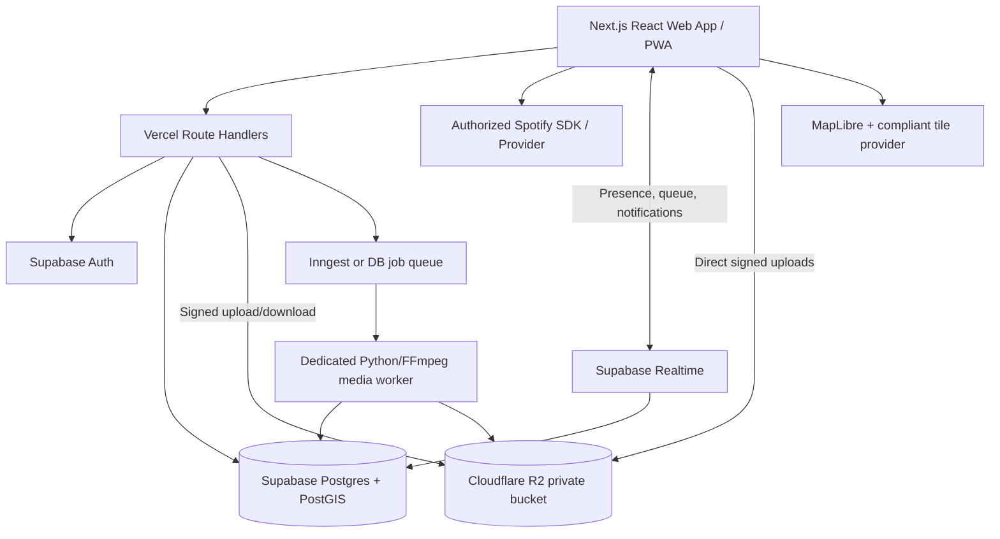
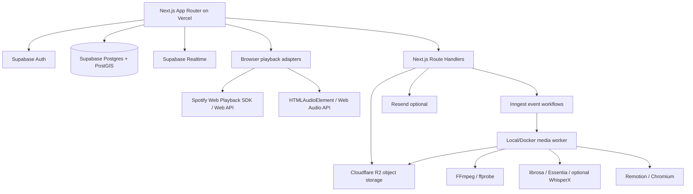

# Original Lyricscape product specification

This is the historical product specification, preserved for design context and future plans. It describes proposed cloud infrastructure, APIs, tools and features that are not necessarily implemented. Use [README.md](../README.md), [architecture.md](architecture.md) and [AGENTS.md](../AGENTS.md) for the current local-first build. These current documents take precedence.

## 1. Product vision

Lyricscape makes music a richer personal and social experience. The player is the center of the app, not a bolt-on. Around it are four experiences:

1. **Listen:** play/search/queue/save music from approved services, especially Spotify; offer a working local/rights-cleared player too.
2. **Visualize:** lyrics bounce, stretch, rotate, pulse, and integrate with original album-inspired graphic design. Focus on the kinetic typography and motion design of the user's Kanye reference, **not AI-generated scenes**.
3. **Remember:** opt-in listening map, listening journals, time capsules, and travel soundtracks.
4. **Party:** a host creates an event and shares a link/QR; guests add songs, photos, and videos. The app displays a collaborative queue, live photo wall, and makes short beat-synced recaps from cleared soundtrack assets.
5. **Discover:** friend recommendations, collections, music journals, and optional social listening rooms.

Reference Instagram reels provided by the project owner:
- https://www.instagram.com/reel/DZDfGBmB99m/
- https://www.instagram.com/reel/DHt8rmnIfjr/
- https://www.instagram.com/reel/Dej1x0US1ou/
- https://www.instagram.com/reel/Ddw-EUqASbL/

The Kanye-inspired animation treatment is the main creative target. Implement original graphics and assets, not copied copyrighted compositions.

## 2. Local-first full-feature development and Spotify integration

A fully functional Spotify player is a priority. Use **Spotify OAuth PKCE**, approved Web API operations and the **Spotify Web Playback SDK** for authorized browser playback, plus Spotify Connect where supported. Spotify SDK web playback needs Premium. Handle token expiry, unavailable endpoints, no active device, 403/429 responses, playback errors, and scope consent.

**Critical 2026 limits:** Spotify Development Mode allows **five authorized test users** and is intended for limited personal development. July 2026 changes increased allowed client IDs to 25 per developer, *not* the five-user beta cap. Spotify policy restricts commercial streaming integrations, mixing/overlapping Spotify sound recordings, modifying/downloading Spotify content, synchronizing Spotify recordings with visual media, AI ingestion of Spotify content, and certain edits to Spotify artwork. A public product needs platform permissions and potentially independent music/lyric/artwork synchronization licenses.

### Development mandate: implement every feature now

**All product features are in scope for local development.** Do not defer the lyric visualizer, album-art compositing, beat-reactive motion, party DJ mixing, highlight editing, listening rooms, or synchronization just because the Spotify provider cannot authorize them. Implement working versions against **user-supplied audio, locally stored artwork, timed lyrics, and test fixtures**. Include UI flows, APIs, persistent models, tests, and actual rendering. Do not replace these features with placeholders.

Spotify is the preferred connected playback service. Integrate official Spotify OAuth, catalog metadata, playback SDK, queue and device controls where available. Keep a fully featured **LocalMediaProvider** alongside Spotify, with the same player UI. If Spotify playback cannot supply raw audio or permit a creative feature, use local media in the creative pipeline, not an assumed raw-audio feed from the streaming SDK. Running locally does not itself waive platform terms or music rights.

**Developer switches:** `NEXT_PUBLIC_ENABLE_EXPERIMENTAL_VISUALS=true`, `ENABLE_LOCAL_DJ_MIXING=true`, `ENABLE_PARTY_RECAP_EXPORT=true`, `ENABLE_LOCAL_AUDIO_ANALYSIS=true`. These enable functional features with eligible local media; they must not silently grant Spotify capabilities. Surface an explicit source selector and precise unsupported states rather than omitting the feature.

Implement a capability-gated provider architecture:

| Feature | Spotify provider | Owned / separately licensed media |
|---|---|---|
| Search, normal playback and device control | Official supported APIs/SDK, authorized user | Yes |
| Library/playlist/queue management | Only accessible supported endpoints | Yes |
| Word-synced kinetic lyric visualization | Requires separate authorization | Yes, with appropriate lyrics rights |
| Album-art compositing | Do not modify Spotify-provided art contrary to policy | Use appropriately licensed artwork |
| Bass/waveform analyses | No extraction or modification of Spotify stream | Yes |
| Cross-song DJ mixing and beatmatched cuts | Not under standard Spotify policy | Yes, when appropriately licensed |
| Soundtrack synchronized to MP4 party recap | Not under standard Spotify policy | Yes, with synchronization/export rights |

An event's song requests can be Spotify track references, but that does not give permission to use those recordings in rendered videos. Show transparent unavailable states rather than fake feature support. **Do not scrape Spotify or lyrics websites.**

```ts
export type ProviderId = 'spotify' | 'licensed' | 'demo';
export type Track = {
  id: string; provider: ProviderId; providerTrackId?: string;
  title: string; artists: string[]; album?: string;
  artworkUrl?: string; durationMs: number; externalUrl?: string;
};
export type PlaybackCapabilities = {
  play: boolean; seek: boolean; queueRead: boolean; queueWrite: boolean;
  deviceTransfer: boolean; synchronizedVisuals: boolean;
  audioAnalysis: boolean; djMixing: boolean; videoExport: boolean;
  artworkCompositing: boolean;
};
export interface MusicProvider {
  capabilities(): PlaybackCapabilities;
  search(query: string): Promise<Track[]>;
  currentTrack(): Promise<Track | null>;
  play(track: Track): Promise<void>;
  pause(): Promise<void>;
  seek(positionMs: number): Promise<void>;
  queue(): Promise<Track[]>;
}
```

Build a real **DemoProvider/LocalLicensedProvider** so development works even without Spotify API access. Do not call it Spotify playback.

## 3. Full feature specification

### A. Player (P0)

Persistent mini-player throughout the app and immersive full player: title/artist/cover, play/pause, seek, next/previous, queue, repeat, shuffle, volume, device indicator, error states. Search and explore provider catalog where allowed. Internal playlists and library. Optional permitted provider-side queue and playlist operations. Media Session API integration, keyboard shortcuts, mobile layout, loading skeletons and optimistic updates that reconcile to real playback state. Clearly show connected provider and whether full music control is supported.

**State machine:** `disconnected`, `connecting`, `ready`, `loading`, `playing`, `paused`, `buffering`, `unavailable`, `error`. Avoid excessive provider polling; honor 429 `Retry-After`, provider quotas, and capability restrictions.

### B. Kinetic lyric visualizer (P1)

Transform **words**, not generated illustrations. Timed words pop, tumble, stack, split, bounce, rotate, swell, warp, disappear behind appropriately licensed foreground elements, and explode into chorus effects. Styles: colorful maximalist, monochrome editorial, psychedelic, minimal, Y2K, and custom. Support expressive typography, variable fonts, multiple layers, shader effects, grain, glow, 2D parallax, gradient backgrounds, particles, and camera motions. Select colors and type direction with original palettes; use licensed image elements only.

For licensed audio, support LRC/enhanced LRC/VTT/structured word timestamps. Provide a timing editor. Optional authorized local transcription with whisper.cpp; do not assume Spotify supplies lyrics. Use a deterministic animation timeline where seeking to any timestamp reconstructs the correct state. Rule-based motion presets are the default; a local/optional AI creative director can output **JSON motion directives**, never AI images. AI cannot ingest restricted Spotify content. Respect reduced-motion settings.

```ts
export type VisualScene = {
  id: string; startMs: number; endMs: number; seed: number;
  preset: string;
  words: { text: string; startMs: number; endMs: number }[];
  effects: { type: string; startMs: number; durationMs: number;
    targetWords: number[]; intensity: number; easing: string }[];
  background: { type: 'solid'|'gradient'|'shader'|'licensedAsset'; assetId?: string };
};
```

Render DOM/SVG/Canvas for text, GSAP for precise schedules, React Three Fiber/Three.js for 3D/shader effects. Export visuals only for rights-cleared media via Remotion/FFmpeg. Target smooth 60 FPS on desktop with lower-end fallback.

### C. Music Map (P1)

Explicit opt-in approximate location logging while the app is permitted to access location. Link authorized, observed listening sessions to coarse location cells/places, timestamp, track, and personal memory note. Map markers/clusters, date sliders, places, trips, travel soundtracks, and time capsules. Let users attach a photo or journal entry and revisit that song later. Music Map can link to private event galleries. Privacy settings: pause, delete individual spots, delete entire history, export data, hide home/work-like areas, configurable retention, precision controls. Never invent retroactive GPS for previously played tracks. Browser geolocation generally requires foreground consent; native background capture would require a future mobile app and separate permissions. Do not expose exact locations publicly.

### D. Party Mode (P0)

Create event with title, time, optional place, privacy/passcode, media permissions and share link/QR. Event roles: host, cohost, member, guest. Guests should be able to join with an event-bound display name and no full app account if authorized. Shared song suggestions, voting, duplicate detection, host approval, reorderable queue, rejection, playback history where legitimately observed, and a big-screen party view. Photos and video uploads go directly into private Cloudflare R2 via short-lived signed URLs. Hosts moderate content and approve the live display. Mobile-friendly upload progress, upload limits, error retries, event deletion/archive, and guest permissions are mandatory.

For the first Spotify-enabled party implementation, use **one authorized host playback device**; guests submit suggestions, not rebroadcast audio. Multi-user remote synchronized playback or DJ mixing depends on additional platform authorization/licensing.

### E. Auto Party Highlight Editor (P1)

Host generates **Quick Recap (30–60s)**, **Highlight Film (1–3min)**, or custom length. Guests' consented photos/videos become a cinematic, editable recap synchronized to **properly licensed audio**. Track suggestions are references, not eligible soundtracks by default.

Pipeline:
1. Ingest media; inspect metadata with ffprobe; generate thumbnails/proxies.
2. Deduplicate via perceptual hashing, reject obvious corrupt/blurry assets, allow manual include/exclude.
3. Respect timestamps and marked must-include memories.
4. Analyze authorized audio with librosa/Essentia for beat, tempo, energy, sections and phrase boundaries.
5. Choose memorable short passages (verse hook/chorus/drop) rather than needlessly using full songs.
6. Build editable JSON timeline: media in/out, song source ranges, transitions, captions and effects.
7. Apply beat-aware cuts, appropriate crossfades and loudness normalization; don't force incompatible songs together.
8. Host previews, trims, swaps clips, adjusts duration, selects allowed soundtrack, regenerates one section.
9. FFmpeg/Remotion worker renders MP4 in 9:16, 1:1, or 16:9 and stores it privately.

Never render a long FFmpeg job inside Vercel HTTP functions. Use background orchestration plus local/deployed dedicated worker. No free always-on video compute is assumed.

### F. Social and discovery (P2)

Profiles, friend requests, shareable song recommendations, journals, Song of the Day, friend-shared collections, private time capsules, event albums, concert memories, listening room chat/presence. Music taste comparisons and derived Spotify analytics need policy review before launch. Support blocking, reporting, activity visibility, and opt-in sharing.

### G. Later (P3)

React Native/Expo app for capture/location; visual preset creator/marketplace; integrated concert memory pages; more polished party display; optional local Ollama for animation style suggestions; rights-cleared smart DJ mode.

## 4. Free-first technology stack

| Area | Primary choice | Why / free consideration |
|---|---|---|
| Hosting | **Vercel Hobby** | Free for **personal non-commercial** development; paid plan for commercial deployment |
| App | **Next.js App Router, TypeScript, React** | Open source, integrated Vercel deployment |
| Styling | **Tailwind CSS, shadcn/ui, Radix UI** | Free/open source; beautiful accessible UI |
| Icons | **Lucide React** | Free/open source |
| Auth, database | **Supabase Auth + PostgreSQL** | Free tier currently 500 MB DB, 50k MAU |
| Realtime | **Supabase Realtime** | Party queue/presence/media updates; quota applies |
| Geospatial | **PostGIS extension** | Location queries in Supabase Postgres |
| Avatar/small files | **Supabase Storage** | Free tier 1 GB storage |
| Party photos/videos | **Cloudflare R2** | Standard free allowance: 10 GB-month, 1M write-class, 10M read-class operations; no egress fees, charge after allowance |
| Map | **MapLibre GL JS** | Open source; map tiles must be sourced responsibly and may have costs |
| Music | **Spotify Web API / Playback SDK**, licensed demo provider | Spotify Premium/dev restrictions apply |
| Player state | **Zustand + TanStack Query** | Open source |
| Validation | **Zod + React Hook Form** | Open source |
| Animations | **GSAP core, Motion** | License-check GSAP usage; SVG/Canvas fallback |
| Visual effects | **Three.js, React Three Fiber, PixiJS optional** | Open source |
| Audio analysis | **librosa / Essentia / Web Audio API** | Free/open source; verify individual licenses |
| Transcription | **whisper.cpp** (optional) | Local for authorized audio; manual lyric corrections |
| Image inspection | **OpenCV, Pillow, perceptual hash** | Open source |
| Media processing | **FFmpeg / ffprobe** | Open source; mind codec distribution/licensing |
| Video timeline/rendering | **Remotion** | License eligibility must be checked; use FFmpeg alone if needed |
| Orchestration | **Inngest** | Currently free ~50k executions/mo; execution != free media compute |
| Alternative jobs | **Trigger.dev** | Alternative to Inngest; free $5 monthly credits; choose one |
| Cache/rate limits | **Upstash Redis** (optional) | Free: 256 MB, 500k commands/mo |
| Email | **Resend** (optional) | Free: 3k emails/mo, 100/day |
| Bot defense | **Cloudflare Turnstile** | Free integration for guest forms/uploads |
| Testing | **Vitest, Playwright, React Testing Library** | Free/open source |
| Errors | **Sentry** optional | Free plan available, inspect quotas |
| Analytics | **Vercel Analytics or privacy-safe internal events** | Free allowance |
| Optional AI | **Ollama** local | No external AI bill; local compute required |

**Minimize services in MVP:** Next.js + Supabase + R2 + Spotify + local FFmpeg worker + MapLibre + animation libraries. Add Inngest, Upstash, Resend only when needed. Do not create separate backend microservices for CRUD. Supabase Free projects may pause after inactivity. Vercel Hobby is not for commercial applications. Recheck pricing before launch.

## 5. Architecture



Vercel runs UI, light API calls, authorization, OAuth, and upload intents. Supabase stores durable data, security policies and realtime presence. R2 stores large user media. A **separate worker** transcodes video and produces recaps. Initial worker runs on the developer machine. Later it needs separately budgeted container/CPU hosting. Never claim a Vercel serverless request can process unlimited videos.

## 6. Database schema plan

Use `uuid` IDs, timestamps, foreign keys, check constraints and **RLS on every user-facing table**. Keep Spotify refresh tokens encrypted server-side and service role keys out of the client.

| Table | Key fields |
|---|---|
| `profiles` | `id, handle, display_name, avatar_key, privacy_settings` |
| `music_connections` | `user_id, provider, provider_user_id, encrypted_token_ref, status` |
| `tracks` | `id, provider, provider_id, title, artists, album, artwork_url, rights_flags` |
| `playlists` | `id, owner_id, title, visibility` |
| `playlist_items` | `playlist_id, track_id, position, added_by` |
| `listening_sessions` | `user_id, track_id, started_at, ended_at, location_id, source` |
| `listening_locations` | `user_id, coarse_geohash, approx_lat, approx_lng, precision_m, visibility` |
| `memories` | `user_id, track_id, location_id, caption, captured_at` |
| `trips` | `id, user_id, name, started_at, ended_at` |
| `events` | `id, host_id, slug, title, starts_at, privacy, status` |
| `event_members` | `event_id, user_id_or_guest_id, role, joined_at` |
| `event_invites` | `event_id, token_hash, expires_at, revoked_at, max_uses` |
| `event_song_requests` | `event_id, track_id, requester_id, status, queue_position` |
| `event_votes` | `request_id, member_id, value` |
| `event_media` | `event_id, uploader_id, object_key, media_type, size, taken_at, approval_status, recap_consent` |
| `event_playback_log` | `event_id, track_id, started_at, ended_at, provider` |
| `visual_projects` | `user_id, licensed_audio_asset_id, preset, status` |
| `lyric_cues` | `project_id, text, start_ms, end_ms, license_source` |
| `visual_scenes` | `project_id, directive_json, seed, start_ms, end_ms` |
| `recap_projects` | `event_id, host_id, target_length_ms, aspect_ratio, status` |
| `recap_timelines` | `project_id, version, timeline_json, created_by` |
| `render_jobs` | `project_id, type, progress, status, attempts, output_key, error` |
| `notifications` | `user_id, type, payload, seen_at` |
| `audit_logs` | `event_id, actor_id, action, metadata, created_at` |

Use indexes on `(event_id, created_at)`, `(user_id, started_at)` and location grid queries. RLS examples:

```sql
alter table public.listening_sessions enable row level security;
create policy "read own sessions" on public.listening_sessions
  for select using (auth.uid() = user_id);
create policy "insert own sessions" on public.listening_sessions
  for insert with check (auth.uid() = user_id);
```

Add update/delete policies separately and secure event membership via server-verified roles. Merely knowing an `event_id` must never grant access. Invite links need hashed/revocable tokens and expiry.

## 7. Screens and routes

- `/` landing/home, logged-in personalized dashboard.
- `/login`, `/settings` authorization, privacy, provider connections.
- `/listen`, `/listen/search`, `/listen/now-playing` real player, queues, search.
- `/library`, `/playlists/[id]` music collections and saved items.
- `/visuals`, `/visuals/new`, `/visuals/[id]` kinetic typography presets/editor/player.
- `/map`, `/memories/[id]` opt-in location history and music memories.
- `/parties`, `/parties/new`, `/parties/[slug]` event overview.
- `/parties/[slug]/queue`, `/gallery`, `/screen`, `/recap` party-specific features.
- `/join/[token]` low-friction guest join on mobile.
- `/discover`, `/profile/[handle]` social features.

Nav: **Listen, Visuals, Map, Parties, Discover, Library**. Persistent mini-player at bottom on desktop/mobile where appropriate. Dark premium UI, minimal clutter, legible text, strong responsive layout. Full-screen mode hides controls after inactivity. Ask for location permission only in context. Guests should add a photo or song in a few taps.

## 8. API plan

```text
GET    /api/health
GET    /api/providers
GET    /api/music/search?q=
GET    /api/music/current
POST   /api/music/play
POST   /api/music/pause
POST   /api/music/seek
GET    /api/music/queue
GET    /api/spotify/callback
POST   /api/spotify/disconnect
POST   /api/events
GET    /api/events/:id
PATCH  /api/events/:id
POST   /api/events/:id/invites
POST   /api/events/:id/join
POST   /api/events/:id/song-requests
POST   /api/events/:id/requests/:requestId/vote
POST   /api/events/:id/media/upload-intent
POST   /api/events/:id/media/complete
GET    /api/events/:id/media
POST   /api/events/:id/recaps
PATCH  /api/recaps/:id/timeline
POST   /api/recaps/:id/render
GET    /api/jobs/:id
POST   /api/visuals
POST   /api/visuals/:id/compile
GET    /api/map/sessions
DELETE /api/map/sessions/:id
POST   /api/memories
DELETE /api/me/data
```

Realtime channels: `party:<id>:queue`, `party:<id>:gallery`, `party:<id>:presence`, `recap:<id>:progress`. Authorize each subscription. Durable data remains in Postgres, not in ephemeral presence broadcasts.

## 9. File layout

```text
lyricscape/
├── README.md
├── .env.example
├── pnpm-workspace.yaml
├── apps/web/
│   ├── app/                    # App Router pages + API handlers
│   ├── components/             # player, visuals, party, maps, UI
│   ├── features/               # domain logic
│   ├── lib/                    # supabase, spotify, r2, security
│   └── tests/
├── packages/
│   ├── types/                  # Zod schemas, shared TS types
│   ├── music-providers/        # Spotify, local licensed, demo
│   ├── kinetic-engine/         # scene compiler and animation logic
│   └── recap-timeline/         # editable timeline contracts
├── workers/media/
│   ├── jobs/                   # transcode, thumbnails, recaps
│   ├── audio/                  # licensed audio analysis
│   ├── video/                  # FFmpeg, rendering helpers
│   ├── Dockerfile
│   └── requirements.txt
├── supabase/migrations/
├── scripts/
├── public/demo/               # only copyright-cleared assets
└── docs/
    ├── architecture.md
    ├── spotify-compliance.md
    ├── media-rights.md
    └── implementation-log.md
```

Prefer a simple single Next.js app in the beginning; move reusable logic into packages only as needed. Avoid premature microservices.

## 10. Setup

### Prerequisites

Node LTS, pnpm, Git, Supabase project/CLI, Vercel account. Spotify Premium + developer credentials for approved playback testing. Cloudflare R2 for party media. Python 3.11+, FFmpeg and ffprobe for local video work.

### `.env.example`

```dotenv
NEXT_PUBLIC_APP_URL=http://localhost:3000
NEXT_PUBLIC_SUPABASE_URL=
NEXT_PUBLIC_SUPABASE_ANON_KEY=
SUPABASE_SERVICE_ROLE_KEY=
SPOTIFY_CLIENT_ID=
SPOTIFY_CLIENT_SECRET=
SPOTIFY_REDIRECT_URI=http://localhost:3000/api/spotify/callback
SPOTIFY_TOKEN_ENCRYPTION_KEY=
R2_ACCOUNT_ID=
R2_ACCESS_KEY_ID=
R2_SECRET_ACCESS_KEY=
R2_BUCKET_NAME=
INNGEST_EVENT_KEY=
INNGEST_SIGNING_KEY=
UPSTASH_REDIS_REST_URL=
UPSTASH_REDIS_REST_TOKEN=
RESEND_API_KEY=
SENTRY_DSN=
MEDIA_WORKER_SECRET=
MAX_UPLOAD_MB=250
```

Never expose the service-role secret, refresh tokens, private storage keys or OAuth client secret in client code. Only use `NEXT_PUBLIC_` for values genuinely safe to expose.

### Run locally (after implementation)

```bash
pnpm install
pnpm dev
```

For local Supabase workflows, after migrations/config exist:

```bash
supabase start
supabase db reset
```

### Deploy

1. Push Git repository; import `apps/web` into Vercel.
2. Configure environment variables for Preview/Production.
3. Configure Supabase redirect URLs, Spotify registered redirects, R2 CORS and storage policies.
4. Run migrations and test RLS using multiple users.
5. Verify authenticated playback controls and party uploads in deployed environment.
6. Run media worker separately from Vercel. Configure safe job retries, resource ceilings and billing alerts.
7. Verify event privacy, data deletion, upload access and all error states before public usage.

## 11. Security and privacy requirements

- Supabase Auth for users; event-scoped guest tokens for guests; signed short-lived invitations.
- Explicit permission for media viewing, downloading and use in recaps.
- Signed R2 upload/download URLs, private buckets, MIME validation, size/duration limits, per-user quotas, bot protection and rate limiting.
- Host moderation, report/block tools, event invitation revocation, upload deletion and audit logs.
- Never store precise location by default, never publish exact location without consent, provide pause/export/delete functions and configurable retention.
- Encryption and proper refresh flow for provider tokens, CSRF and OAuth state validation, least-privilege scopes.
- Respect `prefers-reduced-motion`, keyboard navigation and accessible colors.
- Log operational status only. Don't send raw GPS coordinates, complete lyrics, OAuth secrets, or unapproved party media to analytics tools.
- Review third-party licenses, copyright/synchronization rights and media consent before export.

## 12. Development roadmap

### Phase 0: Foundation
- [ ] Next.js + TypeScript, Tailwind, shadcn/ui, Supabase Auth, RLS and migrations.
- [ ] Premium dark app shell, 6 routes, persistent mini-player.
- [ ] Functional demo/local licensed player with actual copyright-cleared demo audio.
- [ ] Provider abstraction, Zod validation, Vitest and Playwright.

### Phase 1: Spotify player
- [ ] Official OAuth PKCE and token refresh.
- [ ] Current track, search, approved play/pause/seek/device/queue operations.
- [ ] Account connection settings, Premium/dev-mode errors, 403/429 handling.
- [ ] Clear capability restrictions for non-authorized features.

### Phase 2: Real party rooms
- [ ] Create, share QR, join guest, host/member roles.
- [ ] Song suggestions, voting, moderation, realtime updates.
- [ ] Direct-to-R2 media uploads, gallery and big-screen view.
- [ ] Private invites, uploads permissions, rate limits and cleanup.

### Phase 3: Party recap engine (fully functional with local media)
- [ ] FFmpeg/Python worker, job progress and thumbnail pipeline.
- [ ] Quality filtering, duplicates, must-include picks.
- [ ] Authorized audio beat analysis and short segment selection.
- [ ] Editable timeline, preview and MP4 export.

### Phase 4: Kinetic lyric visualizer (fully functional with local media)
- [ ] Timed lyric import/edit.
- [ ] Motion presets and GSAP animation compiler.
- [ ] React Three Fiber effects, licensed visual layers, full-screen mode.
- [ ] Consistent seek/rewind and reduced motion; rights-permitted export.

### Phase 5: Music Map
- [ ] Opt-in foreground capture, PostGIS, location privacy settings.
- [ ] Interactive map, place filters, trip collections and memory notes.
- [ ] Delete/export controls.

### Phase 6: Social and launch readiness
- [ ] Friends, recommendations, song posts, journal, notifications.
- [ ] Responsive/PWA polish, moderation, accessibility and load testing.
- [ ] Commercial hosting/license authorization review and operational cost budgets.

## 13. Acceptance tests

- Spotify pilot user (one of allowed authorized accounts) can log in, play/pause/seek a permitted track and sees accurate failure states; no fake playback.
- New host can create party, share link and QR; guest on different phone can join, upload a photo and suggest song; host sees real-time updates and moderates submission.
- Host selects authorized soundtrack and exports a real 30–60 second MP4 with edited clips and appropriately aligned musical cuts.
- Visualizer plays permitted audio and timed lyric animations, seeks directly to arbitrary timestamps without showing wrong words, respects reduced-motion setting.
- A user opts in to location history, records a coarse location, sees it on map and completely deletes it.
- Tests verify cross-event access denial, revoked invitation rejection, proper R2 signatures, token secrecy, invalid upload handling and job retries.
- CI passes lint, typecheck, unit, integration and E2E smoke tests before claiming completion.

## 14. AI coding-agent instructions

> **Current rules for agents live in [`AGENTS.md`](../AGENTS.md) and take precedence over this section** (the app is now built local-first). The list below is the original brief.

**You are building the actual Lyricscape application. Use this README as the source of truth.**

1. Start with Phase 0 and complete a working vertical slice before adding another feature.
2. Do not generate a static mockup and call it finished. Every control must be wired to working logic or explicitly disabled with explanation.
3. Use **Vercel + Supabase** as architectural foundation. Prefer open-source/free tools. R2 for large media and a separate worker for FFmpeg.
4. Build and test every feature immediately using local, user-provided media where necessary. Spotify integration must be real, but unsupported Spotify capabilities must never block implementation of the equivalent local-media functionality. Use the documented provider interfaces.
5. For visuals, build high-quality animated typography, not AI-generated imagery. Implement artwork masking, lyric timing, beat reactivity and exports using user-provided or appropriately licensed local assets. Spotify-sourced media remains subject to its integration permissions.
6. Implement the full party DJ and recap engine now with local audio: highlight extraction, beatmatching, transitions, audio fades, timed photo/video montages, and MP4 export. Distinguish Spotify song suggestions from usable local soundtrack assets.
7. Make guest joining simple, enforce RLS and event roles on every backend operation, and prevent unauthorized access to event media.
8. Use Zod schemas, strict TypeScript, robust job retry logic, server-side secrets and meaningful error boundaries.
9. Maintain docs and `.env.example`, migrations, reproducible seed data, and real tests. Update `docs/implementation-log.md` after each milestone.
10. Prioritize the mini-player, party join flow and motion typography as the signature UX.

**First assignment:** Scaffold a working Next.js application with Supabase Auth, database migrations/RLS, dark navigation, a real DemoProvider/LocalLicensedProvider playing cleared audio, persistent mini-player, feature routes and smoke tests. Then integrate authorized Spotify playback while concurrently implementing full creative functionality for local audio. Avoid pretending privileged Spotify features are available.

## 15. Official resources and budget notes

Verified October 2026 (check again at launch):

- [Spotify Developer Policy](https://developer.spotify.com/policy)
- [Spotify Web Playback SDK](https://developer.spotify.com/documentation/web-playback-sdk)
- [Spotify development quotas](https://developer.spotify.com/documentation/web-api/concepts/quota-modes)
- [Spotify July 2026 quota changes](https://developer.spotify.com/blog/2026-07-23-web-api-quota-updates)
- [Spotify February 2026 endpoint changes](https://developer.spotify.com/documentation/web-api/references/changes/february-2026)
- [Vercel Hobby](https://vercel.com/docs/plans/hobby)
- [Supabase free plan](https://supabase.com/pricing)
- [Cloudflare R2 free allowance](https://developers.cloudflare.com/r2/pricing/)
- [Inngest free plan](https://www.inngest.com/pricing)
- [Trigger.dev](https://trigger.dev/pricing)
- [Upstash Redis](https://upstash.com/pricing/redis)
- [Resend](https://resend.com/pricing)
- [MapLibre](https://maplibre.org/)
- [GSAP](https://gsap.com/)
- [FFmpeg](https://ffmpeg.org/)
- [Remotion](https://www.remotion.dev/)

**Key financial reality:** The web MVP can start near $0 excluding any Premium account or external provider fees, but unlimited video processing, storage and music licensing are not free. Hosting video workers, commercial Vercel plans and rights-clearance require separate budgets. Never promise a scalable Spotify-based public music service using only a five-user development integration.

---

**North star:** Lyricscape should be a music player people genuinely want to use, a bold kinetic lyric experience they want to watch, a personal map of their musical memories, and a collaborative event space where their friends turn music and photos into memories worth keeping.


---

# Engineering Blueprint — Detailed Implementation Contract

> This section is the authoritative technical expansion of the product specification above. This is a design document, not an assertion that any integration is already built. Every feature must have a real implementation path, explicit dependencies, error handling, and acceptance tests. Do not substitute fake streams, hard-coded data, or pretend Spotify grants access to raw audio. For third-party audio acquisition, implement only authorized downloads and user imports; treat acquisition as a provider-specific integration.

## A. Deployment topology and service ownership



**Deployment distinction:** Vercel serverless functions are for authentication, orchestration, signed upload URLs, metadata, and lightweight reads. Never run multi-minute FFmpeg or large video transcodes inside request handlers. During local development, run the media worker as a Docker Compose service; for deployment, move it to a persistent container/VM or job platform after verifying its pricing and execution limits. Vercel Hobby is not a free commercial production plan. The free tiers and quotas of every vendor can change; confirm them at deployment time.

**Recommended monorepo:**

```text
lyricscape/
  apps/
    web/
      app/(auth)/ app/(app)/ app/api/
      components/player/ components/visualizer/
      components/party/ components/map/
      hooks/ lib/
    worker/
      app/main.py app/jobs/ app/analysis/
      app/render/ app/providers/ tests/
  packages/
    ui/
    database/       # generated Supabase types, migrations, RLS tests
    shared/         # zod schemas, DTOs, event contracts
    player-core/    # provider interfaces, queue state, transport
    visuals/        # timeline interpreter, GSAP, shaders
    timeline/       # editing project schema and validators
    config/
  supabase/migrations/ seed.sql
  infra/docker-compose.yml
  docs/architecture/ adr/ api/ runbooks/
  .github/workflows/
  README.md
```

**Languages:** TypeScript for client/server; Python 3.12+ for audio intelligence; SQL for Postgres migrations. Package management: pnpm workspaces + Turborepo; Python uv. Testing: Vitest, React Testing Library, Playwright, pytest, pgTAP, and k6 for optional load checks. Quality: ESLint, Prettier, Ruff, mypy, GitHub Actions. All have usable free/open-source options.

## B. Complete stack decision matrix

| Concern | Primary | Free/open alternative | Why / caveats |
|---|---|---|---|
| Web framework | Next.js App Router | React + Vite | Next.js works naturally with Vercel |
| Hosting | Vercel | Self-hosted Docker | Hobby noncommercial restrictions |
| UI | Tailwind CSS + shadcn/ui + Radix | CSS Modules | Accessible components, customizable |
| Animation | GSAP core + Motion | Web Animations API | Check GSAP licensing for any paid plugins |
| Canvas/GPU | Three.js + React Three Fiber | PixiJS, Canvas 2D | Shader effects and typography compositing |
| Typography | Variable fonts via Fontsource | System fonts | Verify redistribution/font licenses |
| Auth | Supabase Auth | Auth.js | Email, OAuth, sessions |
| SQL | Supabase PostgreSQL | Local PostgreSQL | Relational consistency, RLS |
| Spatial | PostGIS | Geohash/H3 | Location queries and spatial indexes |
| Realtime | Supabase Realtime | PartyKit, Socket.IO | Presence and event changes |
| Cache/rate limits | Upstash Redis | Local Valkey | Do not require Redis for single-user MVP |
| Upload storage | Cloudflare R2 | Supabase Storage, MinIO | Direct multipart uploads for large files |
| Maps | MapLibre GL JS | Leaflet | Use compliant map tiles; tile hosting may cost |
| Geocoding | Nominatim with usage-policy limits | Photon/self-hosted | No uncontrolled public API bulk geocoding |
| Background orchestration | Inngest | Trigger.dev, pg-boss | Free tier is finite |
| Media processing | FFmpeg + ffprobe | GStreamer | Audio/video processing and muxing |
| Video composition | Remotion | FFmpeg filter graphs | Rendering requires compute; check licensing |
| Audio analysis | librosa + Essentia | aubio | Beats, onsets, tempo, chroma |
| Source separation | Demucs optional | None | GPU-intensive, never a hard dependency |
| Speech/lyric alignment | WhisperX optional | aeneas, manual timing | Transcripts may be imperfect; rights apply |
| Images/video metadata | Sharp + exiftool | Pillow + ffprobe | Strip EXIF for public sharing |
| Media deduplication | pHash + SHA-256 | imagehash | Similarity != consent to discard |
| Object moderation | Host review + rules | Self-hosted models | Require reports, deletion, appeal |
| Email | Resend | SMTP | Invitations and sign-in |
| Monitoring | Sentry optional | OpenTelemetry + logs | Redact tokens and precise location |
| Product analytics | PostHog optional | Umami self-hosted | Opt-in; avoid sensitive listening/location leakage |
| Tests | Vitest/Playwright/pytest | Jest/Cypress | Run CI on pull requests |
| API docs | OpenAPI + Scalar | Swagger UI | Keep endpoints discoverable |
| Validation | Zod + Pydantic | JSON Schema | Shared contracts |
| Secrets | Vercel/Supabase env secrets | .env.local for dev | Never put secrets in NEXT_PUBLIC_ |
| Container dev | Docker Compose | Podman Compose | Worker + DB + object storage locally |

**Free-first rule:** do not require an LLM, paid transcription, GPU, or paid map provider for the main playback, visualizer, party upload, and timeline flows. Any AI-assisted ranking is optional and must have a deterministic fallback.

## C. Music player: complete interaction and provider contracts

**User stories:** sign in, connect Spotify, search artists/albums/tracks, play/pause/seek/skip, control volume, repeat/shuffle, inspect devices, select output, manage queue, follow/save tracks where authorized, browse playlists, use a mini-player on every route, restore session after reload, see network/device errors, switch to local tracks.

**Playback architecture:**
- `PlayerController`: sole command entry point, state machine `idle → loading → ready → playing ↔ paused → ended/error`.
- `SpotifyAdapter`: OAuth authorization code with PKCE, refresh lifecycle, Web Playback SDK device readiness, Connect transfer, SDK event listeners, rate-limit backoff, provider capability checks.
- `LocalAdapter`: `<audio>` / Media Session API, Web Audio API analyzer, blob/file URL lifecycle, local library indexing, playback clock, optional gapless/crossfade engine.
- `PlaybackClock`: monotonic UI position estimate corrected against authoritative provider state; never use `setInterval` alone for timing.
- `QueueManager`: persisted app-level queue entries with provider/source IDs; distinguish local queue from Spotify's remotely controlled queue.
- `SourceResolver`: identify the same recording across catalog metadata and local files using title/artist/duration, but require confirmation for ambiguous matches. Never treat a Spotify URL as an audio URL.
- `CapabilityRegistry`: per-source flags `stream`, `seek`, `readRawPcm`, `visualSync`, `mix`, `export`, `readLyrics`, `artworkTransform`, with an explanation for disabled actions.

**Core endpoints:** `GET /api/music/search`, `GET /api/music/me`, `GET /api/music/devices`, `POST /api/music/play`, `POST /api/music/pause`, `POST /api/music/seek`, `GET /api/music/queue`, `POST /api/music/queue`, `POST /api/music/local/import`, `GET /api/music/library`. Every write validates auth, ownership, provider capability, and idempotency where appropriate.

**Spotify reality checks:** SDK playback and account privileges depend on current Spotify API terms, approved scopes, account eligibility, and development-mode restrictions. Do not assume Spotify supplies synchronized lyrics, PCM, unrestricted queue reads, or mixing rights. An externally hosted web app is not literally 'local-only' even if its users are testers.

**Local audio ingestion:** drag/drop and directory import of real MP3, FLAC, WAV, AAC/M4A when supported; scan ID3/Vorbis tags with `music-metadata` or Mutagen, read embedded cover, calculate SHA-256, fingerprint optionally with Chromaprint/AcoustID, normalize text and build full-text index. Keep original bytes; derive analysis proxies separately. Support downloads only from direct files or sources whose terms and rights permit downloading; a YouTube URL is a reference unless an authorized downloadable asset is available. Keep media acquisition separate from playback and analysis.

**Playback QA:** interrupted connectivity, revoked Spotify access, expired token, no Premium, no active device, seek to zero/end, rapid track switching, browser autoplay denial, multi-tab conflict, file missing, file unsupported, malformed metadata, and playback recovery.

## D. Lyric timing and Kanye-inspired motion design

**Primary visual language:** actual permitted album artwork + kinetic text. No generative scene imagery. Use cover palette, typography, gradients, noise, halftone, mask layers, silhouettes, layered depth, text extrusion, grain, displacement, camera shake, bounce, squash/stretch, wipes, blur, and per-word animations. Do not copy another creator's exact reel assets or protected compositions.

**Pipeline:** timed lyrics (LRC / enhanced LRC / TTML / JSON) → parser → validated word/line intervals → song-section segmentation → motion-director rule engine → timeline JSON → GPU renderer. If only plain lyrics exist, align them against audio the app is allowed to analyze; show confidence and a manual timing editor.

**Motion director rules:** fast syllabic passages use rapid kinetic cuts; sustained vowels use elastic stretch; repeated hooks use accumulating layouts; kick/snare accents trigger restrained punch/scale; chorus uses larger visual hierarchy; instrumental gaps animate the artwork rather than fabricating lyrics. Seeded randomness ensures deterministic replay/export. Accessibility: reduced-motion mode, flashing intensity limits, readable lyric option, safe area and contrast.

**Scene format:**

```ts
type WordCue = {
  id: string; text: string; startMs: number; endMs: number;
  emphasis?: number; effect?: 'pop'|'slide'|'stretch'|'shake'|'mask'|'float';
};
type VisualTimeline = {
  version: 1; trackId: string; durationMs: number;
  artworkAssetId: string; palette: string[];
  cues: WordCue[];
  effects: Array<{ id: string; startMs: number; endMs: number; preset: string; params: Record<string, unknown> }>;
};
```

**Rendering:** use GSAP timeline with playback-time seeking, React Three Fiber for shaders/mesh effects, PixiJS optionally for thousands of text sprites. Never schedule visuals by independent wall clock. Preload fonts/textures. Desktop target 60 FPS where feasible, mobile adaptive quality. Export from the same timeline through a deterministic Remotion/Chromium pipeline only with appropriate media rights.

**Editor:** word timestamp nudging, cue splitting/merging, preset selection, per-line overrides, palette lock, cover crop, layering, undo/redo, draft autosave, preview scrubbing, 9:16/1:1/16:9.

## E. Location-based listening history and music map

**Capture:** explicit consent, configurable approximate/coarse/precise granularity, foreground web geolocation, native mobile background location only with explicit platform permissions. Web browsers cannot guarantee reliable background location capture. Log a listening event only when playback and permitted location samples overlap in time.

**Data:** `listening_sessions`, `location_samples`, `place_clusters`, `memory_notes`, `journeys`, `privacy_zones`. Store exact coordinates separately with restricted access, encrypt sensitive fields where appropriate, and store coarse public-friendly geocells for aggregation. Default private; no public real-time location.

**Spatial:** PostGIS `geography(Point,4326)`, GIST indexes, `ST_DWithin` for proximity, configurable clustering by radius and time, route simplification for journeys. Avoid reverse-geocoding every second; cache approximate place lookups.

**Views:** personal map, place detail with tracks/time, date slider, trip soundtracks, song memories, time capsules, exports, location-history deletion, retention settings. Event location is optional and should not reveal private guests' precise whereabouts.

**Acceptance:** no location collection without opt-in; revoke permission stops future capture; users can export/delete; approximate mode never displays exact coordinate precision; no retrospective invented location data.

## F. Party Mode and collaborative event rooms

**Roles:** host, cohost, member, guest. Invitations are unguessable, expiring and optionally passcode-protected; event owner can rotate/revoke links. Guest uploads require short-lived scoped tokens and upload rate limits.

**Event lifecycle:** draft → scheduled → live → ended → archived; support reopen only by host. Event fields: title, timezone, start/end, optional coarse location, privacy, media retention, guest upload rules, song voting mode, display settings.

**Collaborative playlist:** `event_song_requests` with `requested_by`, provider track reference, votes, status, insertion time; host approval and duplicate detection; fairness algorithm caps repeated requesters and allows host pinning. If playing a Spotify queue, use only supported controls. An event playlist reference does not grant export or remix rights.

**Guest media:** R2 signed multipart upload, MIME sniffing, size/duration constraints, virus scan where available, quarantine → processing → approved/rejected, thumbnail generation, video proxy, EXIF stripping for shared copies, upload progress and resumability. Never expose R2 write credentials to clients.

**Live room:** Supabase Realtime for presence, photo wall, votes, moderation, current queue metadata, chat/reactions. Host is authoritative for playback/playlist state. Use sequence numbers and server timestamps; guests reconnect by fetching latest snapshot then subscribing. For multi-device synchronized playback, each participant needs an authorized playable source and drift correction; never claim one Spotify stream can be broadcast to everybody.

**TV/projector mode:** separate display URL with short-lived display token, approved media only, kiosk UI, landscape layouts, optional QR join overlay, no editing controls. Avoid showing unmoderated uploads immediately.

**Moderation:** reporting, removal, block/ban, guest rate limits, audit logs, deletion on request, host controls, copyright reporting process, content consent notice, retention defaults.

## G. Automatic DJ, highlights and music-aware recap editing

**Input requirements:** raw audio accessible under appropriate rights, time-stamped media, approved event song choices, target output length, aspect ratio, clip priorities, and license flags. Spotify SDK playback is not a raw audio processing source.

**Music analysis worker:**
1. Decode via FFmpeg into analysis format, preserve source.
2. Detect silence, loudness (EBU R128), BPM/beat grid, onset strength, chroma/key estimate, RMS energy.
3. Segment structural sections (intro/verse/build/chorus/drop/outro) using repeat/novelty heuristics.
4. Score candidate highlight windows for energy, phrase boundaries, clear entrances/exits, vocal or instrumental preference.
5. Enforce configurable min/max excerpt length, avoid abrupt cuts, support user overrides.
6. Find cross-song transitions by tempo/key/energy compatibility and phrase alignment; optionally time-stretch conservatively and use equal-power crossfades.
7. Never assume an automatically detected chorus is correct; expose preview and correction.

**Media ranking:** reject corrupt media, calculate blur/exposure/duplicate similarity, detect faces only with explicit product justification and consent, use motion/activity scoring, prioritize manually pinned clips, diversify contributors and chronology. Do not use face recognition for identity by default.

**Edit planner:** timeline object with `tracks` for audio, images, video, text and effects. Clip entries carry `assetId`, `sourceInMs`, `sourceOutMs`, `timelineStartMs`, `durationMs`, `transition`, `crop`, `volume`, `priority`, `pinned`. Preserve original uploads and edits as non-destructive project state.

**Rendering:** Remotion for browser-composited graphics, FFmpeg for decoding, audio mixing, scaling, loudness normalization and MP4 muxing. Render previews at 540p, finals at 1080p when resources allow. Job stages: `queued → analyzing → planning → preview → rendering → complete` with `failed/canceled`; store progress and logs. Use checksums and idempotency keys to prevent duplicate work.

**Three recap presets:** Quick (30–60s), Highlight (1–3min), Extended (configurable). Auto transitions must preserve musical phrasing and narrative chronology where possible. Allow song segment trimming, transition adjustment, media pinning, and export only with cleared rights.

**Example local DJ analysis output:**

```json
{
  "trackAssetId": "audio_123",
  "bpm": 102.4,
  "beatTimesMs": [590, 1176, 1762],
  "highlights": [
    {"startMs": 47500, "endMs": 69500, "score": 0.91, "reason": "high-energy phrase"}
  ],
  "analysisVersion": "1.0"
}
```

These numbers are schema examples, not measurements of a real song.

## H. Social, discovery, profiles, and memory features

**Profiles:** public display name, avatar, privacy level, favorite albums shared by choice, blocked users, friend requests and consent. Never expose private listening/location history by default.

**Music DNA:** opt-in comparisons based on explicitly shared favorites or authorized metadata; avoid hidden profiling and restricted derived Spotify analytics. Explain data sources and disable unsupported comparisons.

**Song of the Day:** one daily post, caption/photo, privacy, comments/reactions, moderation, timezone handling, deletion.

**Journals/capsules:** attach songs to photos, notes, dates, locations (optional), and people only with consent. Time capsules can have unlock dates and private reminders. Do not infer emotional state or sensitive personal traits.

**Discovery:** friend-curated recommendations, collaborative collections, public playlists, event highlights, followed artists where provider supports it, user-submitted tags. Build chronological feeds first; recommendation ML is not required.

**Listening rooms:** participant roles, shared queue proposals, chat/reactions, host play state, per-user licensed playback, sync drift estimates and fallback to asynchronous 'listen along' metadata when unavailable.

**Concert memories:** user-entered setlist, venue, tickets, photos, notes; public venue lookup via licensed mapping/business sources if later needed. Do not expose private tickets or QR barcodes.

## I. Supabase schema and access policy design

All mutable user-owned tables include `id uuid primary key`, `created_at`, `updated_at`; use timestamptz UTC and explicit event timezones. `auth.users` remains managed by Supabase.

| Table | Key fields / relationships | RLS rule summary |
|---|---|---|
| profiles | user_id, handle, avatar, visibility | self write; public fields by visibility |
| provider_connections | user_id, provider, encrypted token reference, scopes | self only; tokens server-side |
| tracks | provider, provider_track_id, title, artist, duration | public metadata or owner-specific |
| media_assets | owner_id, bucket_key, MIME, checksum, status | owner/event role read; uploader/host write |
| local_recordings | owner_id, track_id, media_asset_id, rights flags | owner only |
| lyric_documents | owner_id, track_id, source, language, timed_json | rights/owner constrained |
| playlists | owner_id, title, visibility | owner write, visibility-based read |
| playlist_items | playlist_id, track_id, position | inherit playlist policy |
| player_sessions | user_id, provider, track_id, state | self only |
| listening_sessions | user_id, track_id, start/end, source | self only |
| location_samples | user_id, session_id, geography, precision | self only; never public direct |
| place_clusters | user_id, coarse cell, label | self only |
| journeys | user_id, start/end, visibility | self by default |
| memory_notes | user_id, track_id, media_asset_id, place | self/share explicit |
| friendships | requester, recipient, status | participants only |
| blocks | blocker, blocked | blocker only |
| social_posts | author_id, track_ref, caption, visibility | visibility + blocks |
| reactions | actor_id, post_id, kind | authorized post viewers |
| events | host_id, title, start/end, visibility, state | member/host by role |
| event_members | event_id, user_id or guest token hash, role | member/host only |
| event_invites | event_id, hashed token, expiry, uses | host only; server validates |
| event_song_requests | event_id, track_id, requester, votes, status | members read, host moderates |
| event_song_votes | request_id, voter_id | member write; unique pair |
| event_media | event_id, asset_id, uploader, moderation status | approved to members |
| event_messages | event_id, author, body | member access |
| event_playback_log | event_id, track_ref, start/end, source | members per event settings |
| visual_projects | owner_id, track_id, timeline_json | owner/collaborator |
| recap_projects | event_id, owner_id, timeline_json, status | host/cohost edit |
| render_jobs | project_id, owner_id, progress, error, output_asset | owner/host read |
| reports | reporter, target, reason, status | reporter/authorized moderators |
| audit_logs | actor, action, target, metadata | admin/host scoped |
| notifications | user_id, type, payload, read_at | recipient only |

**Indexes:** unique `(provider,provider_track_id)` when present; `(user_id,started_at DESC)` on listening sessions; GIST on spatial points; `(event_id,status,created_at)` on media and requests; `(project_id,status)` on jobs. Partition large activity tables only when justified by scale.

**RLS requirements:** enable on every exposed table; default deny; policies based on `auth.uid()` and narrowly scoped membership helper functions; guests never receive broad database credentials; use server-validated signed tokens. Service-role keys must never reach the browser. Test cross-user read/write denial, blocked user access, expired invite access, revoked membership, and direct object key guessing.

**Storage:** private buckets for originals, processed previews, covers, recap exports; signed GET URLs with short TTL. Database stores object keys, not permanent public URLs. Use object lifecycle deletion for abandoned uploads and expired exports.

## J. API and event contracts

| Route | Method | Purpose |
|---|---|---|
| `/api/auth/spotify/start` | GET | PKCE authorization |
| `/api/auth/spotify/callback` | GET | Validate state, exchange code |
| `/api/music/search` | GET | Search selected provider |
| `/api/music/player` | GET/POST | Read and command player |
| `/api/music/local/import` | POST | Create upload/import job |
| `/api/lyrics/:trackId` | GET/PUT | Retrieve/update permitted lyrics |
| `/api/visuals/projects` | GET/POST | List/create visual timelines |
| `/api/visuals/projects/:id` | GET/PATCH | Edit visual project |
| `/api/map/sessions` | GET/POST | Read/create listening sessions |
| `/api/map/places` | GET | Aggregated private places |
| `/api/events` | GET/POST | List/create parties |
| `/api/events/:id/invite` | POST | Create/revoke invitations |
| `/api/events/:id/join` | POST | Join with valid token |
| `/api/events/:id/songs` | GET/POST | Queue requests |
| `/api/events/:id/media/upload-url` | POST | Signed direct upload |
| `/api/events/:id/media/:assetId` | PATCH/DELETE | Moderate/remove |
| `/api/events/:id/recaps` | POST | Generate recap project |
| `/api/recaps/:id/timeline` | GET/PATCH | Edit recap |
| `/api/recaps/:id/render` | POST | Start render |
| `/api/jobs/:id` | GET | Progress and errors |
| `/api/social/posts` | GET/POST | Social feed |
| `/api/me/export` | POST | Personal data export |
| `/api/me/delete` | POST | Deletion workflow |

**Conventions:** Zod/Pydantic request validation; cursor pagination; `Idempotency-Key` on expensive POSTs; structured error `{code,message,requestId,retryAfter?}`; per-user and per-event rate limits; audit privileged actions. Supabase Realtime broadcasts `event.song.updated`, `event.media.approved`, `event.playback.changed`, `event.member.joined`, `render.progress` using scoped channels. Persist durable state in Postgres, not only websocket memory.

## K. Authentication, security, privacy, and abuse prevention

- Spotify OAuth: PKCE, state verification, minimal scopes, token refresh, disconnect/revoke, no tokens in client logs.
- Supabase Auth: verified email, optional passkeys later, secure cookie handling, CSRF protection for relevant actions.
- Media: signed upload URLs, size/type quotas, file signature validation, malware scanning option, no arbitrary URL fetch without SSRF protections, transcoding isolation.
- Party links: random token at least 128 bits, hashed at rest, expiration, guest privileges scoped to one event, rotation.
- Location: opt-in per device, clear privacy status, approximate-by-default, data retention controls, location deletion, no guest geolocation inference.
- Permissions: RLS plus server-side checks; never trust client-supplied `owner_id`, `event_id` membership, or `rightsCleared`.
- Rate limiting: account/IP/device controls, upload caps, anti-spam voting, moderation and reporting.
- Secrets: `.env.example` only contains names, never real keys; use Vercel and Supabase secret managers.
- Observability: redact tokens, raw lyrics where unnecessary, GPS, uploaded media URLs, and private event data.
- Backups: database PITR when plan permits, scheduled logical exports in development, restore drills, storage lifecycle policy.
- Copyright and provider compliance: record source provenance and granted usage rights; do not infer permission from the ability to stream a song.

## L. Configuration contract

```dotenv
# Public frontend
NEXT_PUBLIC_APP_URL=http://localhost:3000
NEXT_PUBLIC_SUPABASE_URL=
NEXT_PUBLIC_SUPABASE_ANON_KEY=
NEXT_PUBLIC_MAP_STYLE_URL=
NEXT_PUBLIC_ENABLE_LOCAL_VISUALIZER=true

# Server only
SUPABASE_SERVICE_ROLE_KEY=
DATABASE_URL=
SPOTIFY_CLIENT_ID=
SPOTIFY_CLIENT_SECRET=
SPOTIFY_REDIRECT_URI=http://localhost:3000/api/auth/spotify/callback
R2_ACCOUNT_ID=
R2_ACCESS_KEY_ID=
R2_SECRET_ACCESS_KEY=
R2_BUCKET=
R2_PUBLIC_BASE_URL=
INNGEST_EVENT_KEY=
INNGEST_SIGNING_KEY=
UPSTASH_REDIS_REST_URL=
UPSTASH_REDIS_REST_TOKEN=
RESEND_API_KEY=
MEDIA_WORKER_SHARED_SECRET=
ENABLE_LOCAL_DJ_MIXING=true
ENABLE_PARTY_RECAP_EXPORT=true
ENABLE_LOCATION_HISTORY=false
```

For a public OAuth PKCE client, never embed a client secret in the browser; use the appropriate server-side exchange strategy and current provider documentation. Optional services should fail gracefully when keys are absent.

## M. Local development workflow and deployment

**Prerequisites:** Node.js LTS, pnpm, Python 3.12+, uv, Docker, FFmpeg, Supabase CLI. Optional: local MinIO, GPU for heavy analysis. Use real imported audio files that the developer is authorized to process; do not rely on synthetic placeholder playback.

1. Install dependencies with `pnpm install` and `uv sync` in the worker.
2. Start local Supabase with `supabase start`; apply versioned migrations.
3. Start local worker, queue service and MinIO with Docker Compose.
4. Copy `.env.example` to `.env.local`, fill credentials.
5. Run `pnpm dev` for the web app; run worker in its own process/container.
6. Create a user; connect an eligible Spotify account and verify real SDK playback.
7. Import an actual authorized recording and timed lyrics; verify visualizer seeks accurately.
8. Create a party, open its invite in a second browser profile, upload real media, submit song requests.
9. Generate a recap from authorized local audio, review its timeline, render and download MP4.
10. Enable opt-in location, record a listening session, inspect the private Music Map, then revoke permission and delete data.

**Vercel deployment:** connect Git repo, set root to `apps/web`, configure env vars and build, point callback URLs to deployment domain. Keep FFmpeg worker off Vercel serverless; use a dedicated worker endpoint secured by shared secrets/service auth. Configure R2 CORS for direct uploads, Supabase Auth redirect allowlist, webhooks, and database connection pooling.

**Cost guardrails:** enforce per-user storage quotas, media retention windows, max event file count/size, preview-first rendering, concurrency limits, upload expiry, and a worker job budget. Real music licensing is not provided by a free infrastructure tier.

## N. Milestones with exit criteria

| Milestone | Deliverable | Exit test |
|---|---|---|
| M0 Foundation | Repo, Supabase, auth, RLS, CI, design system | Login + cross-user isolation tests |
| M1 Player | Spotify SDK adapter, local library, shared queue UI | Real eligible Spotify stream + real local file play/pause/seek |
| M2 Visualizer | Timed lyrics, GPU typography, artwork, editor | Words land on correct timestamps and seek correctly |
| M3 Party Core | Event links, roles, upload, voting, live gallery | Two browsers collaborate; unauthorized users blocked |
| M4 DJ + Recaps | Analysis, timeline, previews, render | Real authorized audio + user clips produce playable MP4 |
| M5 Music Map | Opt-in capture, PostGIS, journeys, privacy | Map displays captured sessions; revoke/delete work |
| M6 Social | Friends, Song of the Day, journals, rooms | Permission and moderation tests pass |
| M7 Hardening | Mobile, performance, accessibility, monitoring | Load, security, accessibility and restore checks |

**Definition of done for every feature:** actual user interaction; persistent data; authenticated authorization; loading/error/empty states; automated test coverage; realistic real-media integration test; documented provider limits; no fake buttons or fabricated output.

## O. Known engineering risks and fallback designs

1. **Spotify developer limits:** restricted accounts, API scopes, eligibility or approval. Fallback: functioning local library; do not misrepresent Spotify capabilities.
2. **Spotify raw audio unavailable:** beat analysis and mixing cannot operate on SDK audio. Fallback: user-imported authorized recordings; no capture workaround.
3. **Lyrics licensing/timing gaps:** user-supplied timed lyrics and manual alignment editor.
4. **Browser background geolocation:** not reliable. Fallback: foreground capture and future native app.
5. **Long render jobs:** Vercel function timeout. Fallback: persistent Docker worker.
6. **Video storage cost:** R2 quotas and lifecycle policies, client compression, bounded uploads.
7. **Multi-device synchronization:** clock drift and licensing. Fallback: synchronized state/queue metadata rather than falsely claiming synchronized audio.
8. **Automatic music segmentation mistakes:** manual segment pinning and preview.
9. **Guest abuse:** approval queues, invite revocation, quotas and moderation.
10. **Complexity creep:** deliver vertical slices with shared schemas; avoid a monolithic 'AI agent' implementation.

## P. Instructions for coding agents

> Current agent rules: [`AGENTS.md`](../AGENTS.md) (takes precedence over this section).

Implement the product as a working system, not a design-only demo. Follow milestone order and create one fully tested vertical slice before expanding. Do not remove features from the target scope merely because a provider integration is restricted; instead implement the underlying feature against a legitimate playable source and mark provider-specific limitations honestly. Never silently substitute mock tracks for user-requested real playback.

When implementing a feature, first list its tables, API routes, auth/RLS policies, UI states, background jobs, tests, and external dependencies. Then build it end-to-end. Keep the music player as the persistent shell of the application. Ensure all modules use the same canonical track, asset, event and timeline identifiers. Document tradeoffs in ADRs. Treat privacy, guest permissions, and media rights as engineering requirements.

**Product north star:** A real music player where album art and lyrics come alive, songs become place-based memories, and friends can turn shared parties into collaborative, music-driven experiences.
